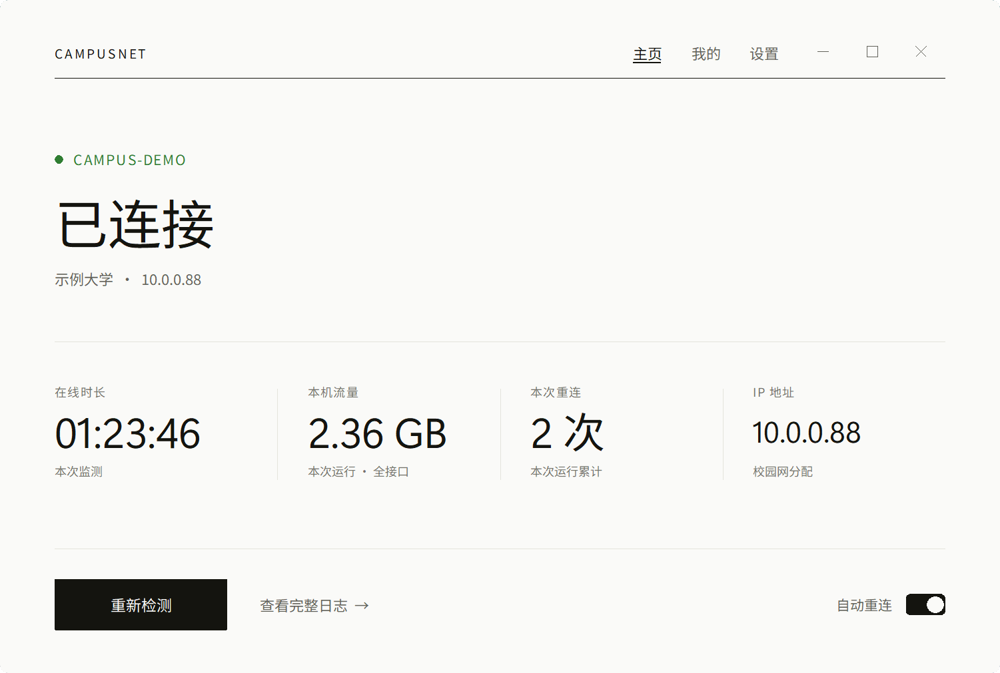
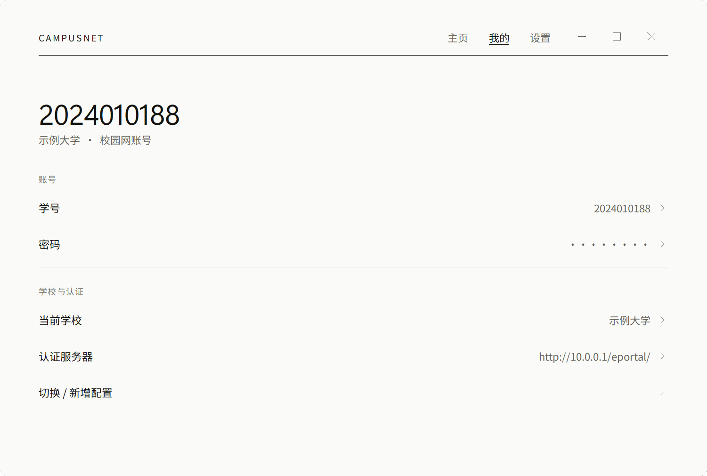
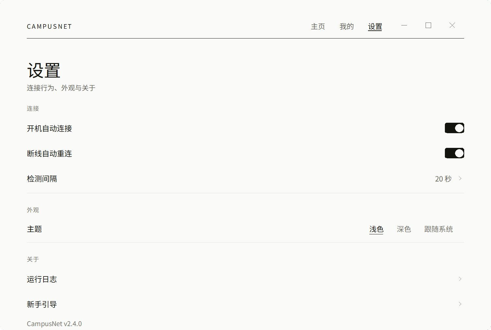
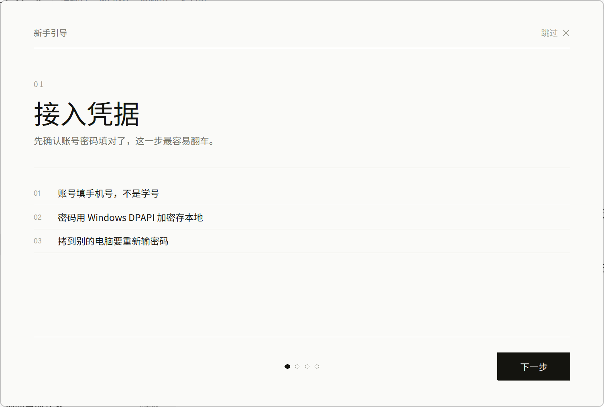

# CampusNet 校园网自动认证

[](https://github.com/AHAONB666/CampusNet/releases/latest)
[](LICENSE)
[](https://github.com/AHAONB666/CampusNet/releases/latest)
[](https://www.python.org/)

一个 Windows 桌面端的校园网 Portal 自动认证工具：断网自动重连、开机静默守护、支持多学校配置，带浅色/深色/跟随系统三种主题与内置新手引导。


## 功能

- **自动认证**：检测网络断开（`generate_204` 探测，绑定 WLAN 网卡 IP，绕过 VPN/TUN 干扰）后自动发起 Portal 认证
- **双认证引擎**：
  - ePortal（Dr.COM）：`InterFace.do?method=login`，含服务选择与 keepalive 心跳
  - 通用表单：HTMLParser 解析认证页，字段名打分自动匹配（兼容 srun、锐捷等）
- **静默守护**：`--silent` 后台运行，每 20 秒巡检一轮 SSID 与连通性，失败按 8→16→32…256 秒指数退避（退避序列以 `retry_interval` 为基数倍增，指数最多 5 级，因此默认基数 8 时封顶 256 秒；绝对上限 300 秒）
- **安全存储**：密码使用 Windows DPAPI（`CryptProtectData`）加密，旧版 XOR 密文自动迁移
- **硬错误保护**：识别「密码错误 / 账号已锁 / 欠费」等提示后主动停手，避免账号被刷锁
- **多学校配置**：多套 SSID + 认证地址 profile，可随时切换
- **三页签界面**：主页（状态与数据）/ 我的（身份与偏好）/ 设置（配置），浅色、深色、跟随系统三种主题
- **新手引导**：首次启动自动弹出四步引导（内置在程序里，跟随主题），点「开始使用」后不再自动弹出
- **托盘常驻**：点最小化（—）收进托盘，守护继续运行；点关闭（✕）则直接退出程序。右键托盘图标可显示主界面或退出

## 快速开始

1. 双击 `CampusNet.exe`，或运行 `launcher\启动CampusNet.vbs`
2. 首次启动会自动弹出四步新手引导，看完点「开始使用」
3. 切到「我的」页签，填写学号与密码（也可点行内直接改）
4. 回到「主页」点「连接」
5. 需要开机自启：在「设置」页签打开「开机自动连接」

想再看一遍引导：删掉 `launcher\guide.skip` 后重新启动即可。

## 目录结构

```
CampusNet\
├─ CampusNet.exe            # 主程序（PyInstaller onefile，Python 3.8）
├─ src\                     # 源码
│  ├─ ui_scifi.py           # 程序入口（--silent 静默守护 / --classic 旧版三主题）
│  ├─ ui_quiet.py           # 界面：主页 / 我的 / 设置三页签 + 新手引导，双主题
│  ├─ tray.py               # 托盘图标（Shell_NotifyIcon，无第三方依赖）
│  ├─ guard.py              # 守护循环：巡检 / 重连 / 退避
│  ├─ eportal.py            # ePortal(Dr.COM) 认证引擎
│  ├─ portal.py             # 通用表单认证引擎
│  ├─ netutil.py            # 网卡 / SSID / 连通性探测
│  ├─ httpclient.py         # HTTP 客户端封装
│  ├─ config.py             # 配置读写与 DPAPI 密码保护
│  ├─ settings.py           # 高级设置：多学校 / 认证页 / 字段映射
│  ├─ autostart.py          # 开机自启注册表管理
│  ├─ diag.py               # 诊断
│  └─ win11fx.py            # Win11 界面效果
├─ launcher\
│  └─ 启动CampusNet.vbs      # 无黑框启动入口（纯启动，不再承担引导）
└─ assets\
   ├─ icon.ico / icon.png      # 图标
   ├─ screenshot-home.png      # 主页截图
   ├─ screenshot-me.png        # 我的页截图
   ├─ screenshot-settings.png  # 设置页截图
   └─ screenshot-guide.png     # 引导界面截图
```

## 界面

三页签：主页 / 我的 / 设置。





## 新手引导



引导是普通窗口内的一屏，与主界面同一套配色和圆角体系；四步分页，点「开始使用」或右上角「跳过 ✕」（或按 Esc）后写入 `launcher\guide.skip`，之后启动不再自动弹出。

## 运行要求

- Windows 10 / 11
- 主程序为独立 exe，无需 Python 环境，也不依赖 PowerShell

## 配置说明

`config.json`（**含账号与加密密码，请勿提交/外传**）：

```json
{
  "version": 2,
  "active": "campus-demo",
  "profiles": [{
    "id": "campus-demo",
    "name": "某某大学",
    "ssid": "CAMPUS-DEMO",
    "username": "2024010188",
    "password": "dpapi:...",
    "portal_url": "",          // 留空 = 自动探测；已知可填死更稳
    "user_field": "",          // 账号表单字段名，留空则自动识别
    "pwd_field": "",           // 密码表单字段名，留空则自动识别
    "extra_params": ""         // 形如 a=1&b=2，一并提交给认证接口
  }],
  "auth_type": "auto",         // auto / eportal / form —— 全局项，不在 profile 内
  "check_interval": 20,
  "retry_interval": 8,
  "auto_start": true,
  "auto_reconnect": true
}
```

## 常见问题

- **日志刷屏「没有分配给指定接口的配置文件」**：先用 Windows 手动连一次目标 WiFi 并勾选「自动连接」，`netsh wlan connect` 需要已存的配置文件
- **偶尔「未探测到认证页」**：自动探测依赖 204 劫持，网络抖动时会失败；在设置里把认证页地址填死
- **换电脑后密码失效**：DPAPI 密文绑定本机当前用户，换机需重填密码

## 免责声明

本项目仅供学习与技术交流使用，不构成对任何校园网认证协议的官方实现。
使用者应遵守所在学校或机构的网络管理规定及相关法律法规；因违规使用本项目产生的一切后果由使用者自行承担，作者不承担任何责任。
请勿将本项目用于未经授权的网络访问。

## License

[MIT](LICENSE)
